<!-- Northwind Labs · Project visibility report · 22 Oct – 04 Nov 2026 -->

# 📊 Project Visibility Report — Internal Tools

| | |
|---|---|
| **Reporting Period** | 22 Oct – 04 Nov 2026 |
| **Project** | Internal Tools |
| **Owner** | Karthik Rao, Sanjay Gupta |
| **Status** | 🟡 In Progress |

---

# 🎯 Sprint Goal & Objectives

> **Sprint Goal:** Deliver the 5 planned tasks for Internal Tools — CI pipeline caching; Weekly sprint review; Migrate staging database.

| 🎯 Planned Tasks | ✅ Completed | 🚧 In Progress | 📅 Pending | 📊 Sprint Progress |
|:---:|:---:|:---:|:---:|:---:|
| **5** | **1** | **2** | **2** | **20%** |

---

# 📈 Sprint Dashboard

## Sprint Status Distribution

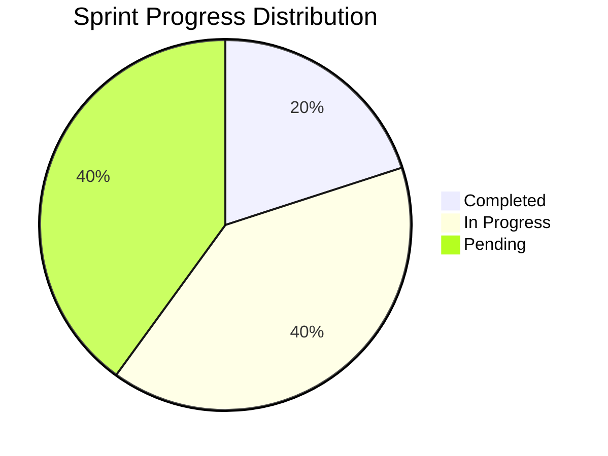

---

# 🚀 Internal Tools Workflow

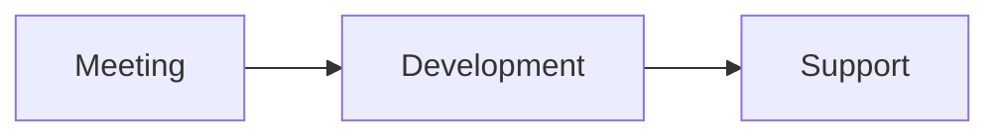

---

## Current Activities

| Activity | Status |
|---|---|
| CI pipeline caching | ✅ Completed |
| Weekly sprint review | 🚧 In Progress |
| Migrate staging database | 🚧 In Progress |
| Time-tracking widget feedback | 📅 Pending |
| E2E created task 1793782560143 | 📅 Pending |

---

# ✅ Completed Deliverables

| # | Deliverable | Status |
|---|---|:---:|
| 1 | CI pipeline caching | ✅ |

---

# 📈 Work Distribution

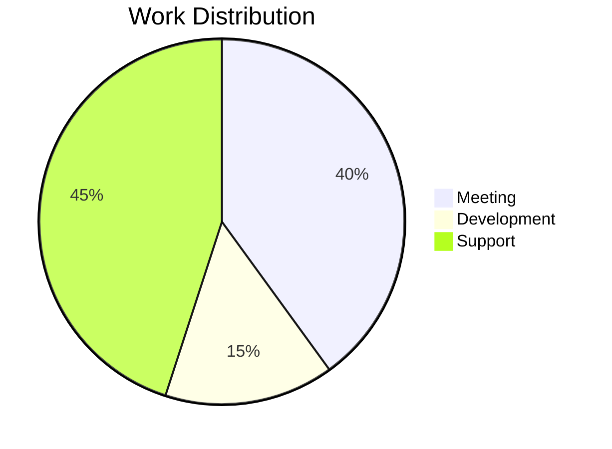

---

# 📊 Project Visibility Report — Mobile App

| | |
|---|---|
| **Reporting Period** | 22 Oct – 04 Nov 2026 |
| **Project** | Mobile App |
| **Owner** | Meera Pillai, Sanjay Gupta |
| **Status** | 🟡 In Progress |

---

# 🎯 Sprint Goal & Objectives

> **Sprint Goal:** Deliver the 6 planned tasks for Mobile App — Crash reporting setup; Onboarding screens design; Push notification service.

| 🎯 Planned Tasks | ✅ Completed | 🚧 In Progress | 📅 Pending | 📊 Sprint Progress |
|:---:|:---:|:---:|:---:|:---:|
| **6** | **2** | **3** | **1** | **33%** |

---

# 📈 Sprint Dashboard

## Sprint Status Distribution

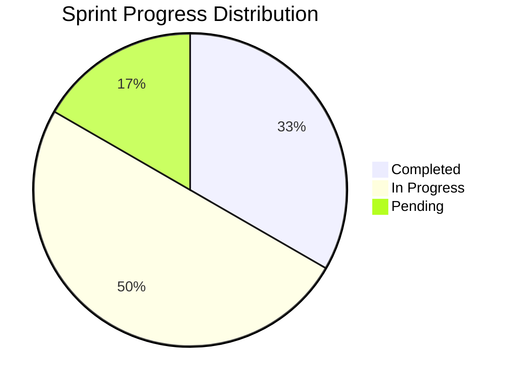

---

# 🚀 Mobile App Workflow

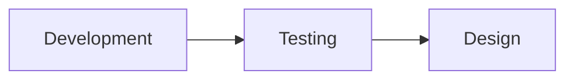

---

## Current Activities

| Activity | Status |
|---|---|
| Crash reporting setup | ✅ Completed |
| Onboarding screens design | ✅ Completed |
| Push notification service | 🚧 In Progress |
| App store release checklist | 📅 Pending |
| Biometric login | 🚧 In Progress |
| Offline mode sync engine | 🚧 In Progress |

---

# ✅ Completed Deliverables

| # | Deliverable | Status |
|---|---|:---:|
| 1 | Crash reporting setup | ✅ |
| 2 | Onboarding screens design | ✅ |

---

# 📈 Work Distribution

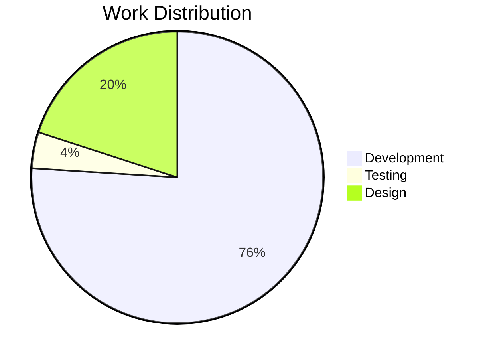

---

# 📊 Project Visibility Report — Website Revamp

| | |
|---|---|
| **Reporting Period** | 22 Oct – 04 Nov 2026 |
| **Project** | Website Revamp |
| **Owner** | Karthik Rao |
| **Status** | 🟡 In Progress |

---

# 🎯 Sprint Goal & Objectives

> **Sprint Goal:** Deliver the 7 planned tasks for Website Revamp — Implement responsive navigation; Redesign landing page hero; Payment gateway sandbox access.

| 🎯 Planned Tasks | ✅ Completed | 🚧 In Progress | 📅 Pending | 📊 Sprint Progress |
|:---:|:---:|:---:|:---:|:---:|
| **7** | **2** | **3** | **2** | **29%** |

---

# 📈 Sprint Dashboard

## Sprint Status Distribution

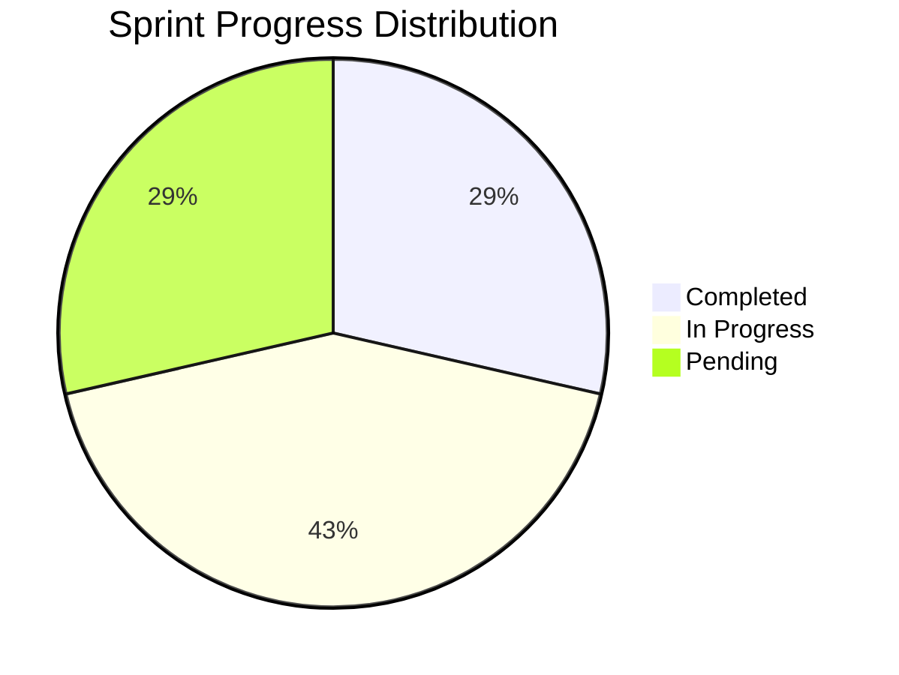

---

# 🚀 Website Revamp Workflow

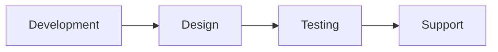

---

## Current Activities

| Activity | Status |
|---|---|
| Implement responsive navigation | ✅ Completed |
| Redesign landing page hero | ✅ Completed |
| Payment gateway sandbox access | 🚧 In Progress |
| Checkout flow usability tests | 🚧 In Progress |
| SEO metadata audit | 📅 Pending |
| Product catalogue API integration | 🚧 In Progress |
| Cart discount rules | 📅 Pending |

---

# ✅ Completed Deliverables

| # | Deliverable | Status |
|---|---|:---:|
| 1 | Implement responsive navigation | ✅ |
| 2 | Redesign landing page hero | ✅ |

---

# 📈 Work Distribution

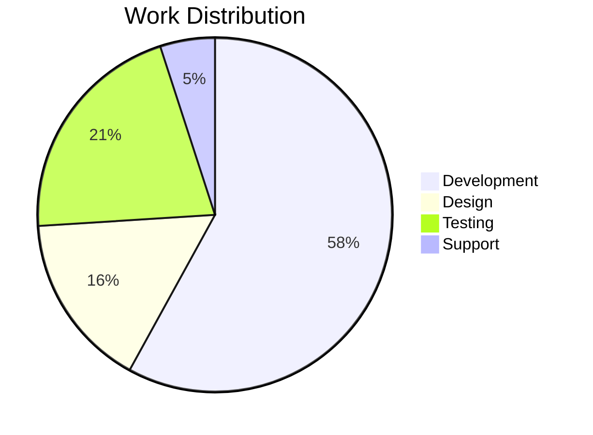

---

# 📊 Combined Sprint Health Dashboard

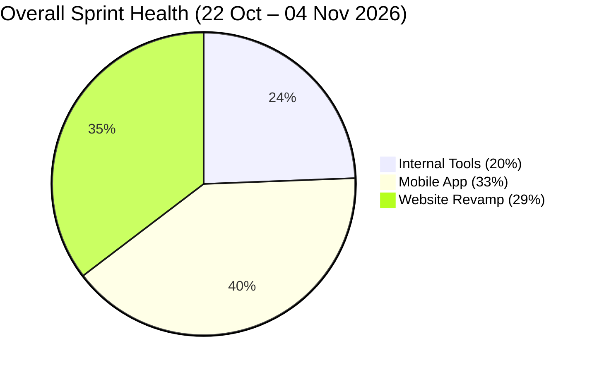

---

# 📊 Summary Dashboard

| Project | Owner | Progress | Status | Key Achievement |
|---|---|---|---|---|
| Internal Tools | Karthik Rao, Sanjay Gupta | 20% | 🟡 | 1 of 5 tasks completed; latest: CI pipeline caching |
| Mobile App | Meera Pillai, Sanjay Gupta | 33% | 🟡 | 2 of 6 tasks completed; latest: Onboarding screens design |
| Website Revamp | Karthik Rao | 29% | 🟡 | 2 of 7 tasks completed; latest: Redesign landing page hero |

---

# 📊 Team Work Distribution

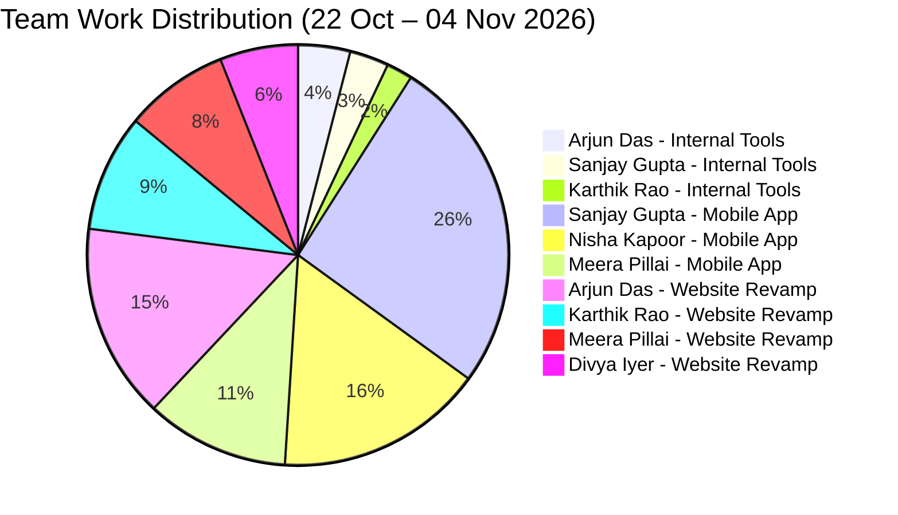
